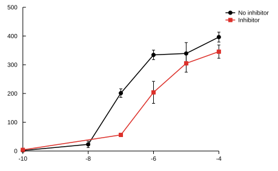

# rea-prism

A desktop application for GraphPad Prism documents, written in Rust. It reads and
writes both Prism file formats, edits data tables, and draws Prism's graph
families — without Prism installed.

The file formats were recovered from a shipped copy of Prism 11.0.2; see
[`docs/FORMAT.md`](docs/FORMAT.md) for the specification and the evidence behind
it.



## What works

* **Open** `.prism`, `.prismt`, `.pzfx` and `.xml` documents — the format is
  detected from the file's contents, not its extension.
* **Edit** data sheets in a spreadsheet view: all eight Prism table kinds,
  replicates, mean/SD/N subcolumns, text and date columns.
* **Graph** any sheet in ten families — XY, bar, column scatter, box and
  whisker, violin, survival, pie and donut, heatmap, bubble, dendrogram — with
  full control over axes, scales, ticks, symbols, lines, fills, error bars and
  legends.
* **Save** back to `.prism` or `.pzfx`. Entries the model does not cover are
  preserved byte for byte, so saving never silently discards part of a document.
* **Export** a graph to SVG, or a sheet to CSV.

## What does not

**Classic graphs do not round-trip their appearance.** Prism stores the look of
XY, Column, Grouped, Survival and Parts-of-whole graphs in an undocumented binary
blob (`PCFFGRA4`), not in JSON. Opening a document that contains one shows the
graph rebuilt from its data with Prism's defaults, which is usually close but is
not the saved appearance. The original blob is kept and written back unchanged,
so nothing is lost — Prism still opens the file and shows the real graph. Only
the newer multivariable graphs (dendrogram, heatmap, bubble) store their settings
in a readable form.

**Statistics are not implemented.** Analyses in an opened document are carried
through with their stored parameters and results; this build does not recompute
them. The summary statistics behind the graphs (mean, SD, SEM, quartiles, kernel
density for violins) are computed, but no hypothesis test or regression is.

## Install

Needs a Rust toolchain (1.82 or newer). If you do not have one:

```sh
curl --proto '=https' --tlsv1.2 -sSf https://sh.rustup.rs | sh
```

Then:

```sh
git clone https://github.com/conmmul/rea-prism
cd rea-prism
cargo build --release
```

The result is a single self-contained binary at `target/release/rea-prism`.
Copy it anywhere on your `PATH`.

### A macOS app bundle

```sh
./scripts/bundle-macos.sh
```

writes `dist/Prism.app`, which you can drag to `/Applications` and open from
Finder. It is unsigned, so the first launch needs right-click → Open.

## Use

```sh
rea-prism                      # start with an empty XY sheet
rea-prism experiment.prism     # open a document
```

You can also drop a document onto the window.

| | |
| --- | --- |
| `Cmd-O` | Open |
| `Cmd-S` | Save |
| `Cmd-Shift-S` | Save As |
| `Cmd-G` | New graph from the selected sheet |

Pick a sheet in the navigator on the left. Data sheets open in the grid; click a
cell to type into it. **New graph** builds the graph Prism would make by default
for that table, and the format panel on the right changes everything about it.

## As a library

```toml
[dependencies]
prism-doc = { git = "https://github.com/conmmul/rea-prism" }
prism-render = { git = "https://github.com/conmmul/rea-prism" }
```

```rust
use prism_doc::graph::GraphSpec;

let doc = prism_doc::open("experiment.prism")?;
let sheet = &doc.data_sheets[0];

for (i, y) in sheet.table.ys.iter().enumerate() {
    let values: Vec<f64> = sheet.table.values
        .numeric_column(sheet.table.y_offset(i))
        .collect();
    println!("{}: n={}", y.title, values.len());
}

let spec = GraphSpec::default_for_table(&sheet.table);
std::fs::write("graph.svg", prism_render::to_svg(&prism_render::render(&sheet.table, &spec)))?;

prism_doc::save(&doc, "copy.pzfx")?;   // format chosen from the extension
# Ok::<(), prism_doc::Error>(())
```

Headless SVG export without the GUI:

```sh
cargo run -p prism-render --example export -- experiment.prism ./out xy
```

## Layout

| Crate | |
| --- | --- |
| `prism-doc` | Document model, `.prism` and `.pzfx` readers and writers |
| `prism-render` | Scales, layout, the ten plot families, SVG output |
| `prism-gui` | The `rea-prism` application |

`prism-render` emits a backend-independent list of primitives, so the GUI and the
SVG exporter draw identical geometry.

## Tests

```sh
cargo test --workspace
```

Beyond unit tests, the suite runs against the 78 sample documents inside a local
`Prism 11.app`: every one is parsed, round-tripped through both writers with its
cell values compared, and rendered in all ten graph families with every
coordinate checked. Those tests skip themselves when Prism is not installed. They
have already caught three real bugs: a dropped date subcolumn, an index underflow
in the dendrogram, and row titles being silently discarded on read.

## Licence

MIT or Apache-2.0, at your option.

Not affiliated with GraphPad Software. "Prism" and "GraphPad" are their
trademarks. This project reads and writes their file formats; it contains no
GraphPad code.
